# Assignment 6 — Capstone: Deploy Book Review App (Three-Tier Architecture) on Azure

Part of the DevOps Micro Internship (DMI) with Agentic AI

---

## Purpose

Deploy the Book Review App in a production-style three-tier architecture on Azure, with private application and database tiers, public and internal Load Balancers, protected secrets, monitoring, and restart-recovery testing.

---

# Task 1 — Design the Azure Three-Tier Architecture

## Goal

Create an architecture diagram and implementation plan showing the selected Azure services, subnet ranges, application ports, administration path, and traffic flow.

## Evidence

#### Screenshot 1 — Architecture diagram showing the public entry point, three tiers, network boundaries, and traffic flow

---

#### Architecture Notes

<<<<<<< HEAD
# Book Review App — Architecture Assumptions and Selected Azure Services

## Architecture Assumptions

The Book Review App will be deployed using a three-tier architecture that separates the presentation, application, and database layers. The design is intended to improve security, scalability, availability, and maintainability.

* The Azure deployment will use a dedicated **Virtual Network (VNet)** with separate subnets for each application tier.
* The **Web/Presentation Tier** will host the Next.js frontend and Nginx reverse proxy.
* The **Application Tier** will host the Node.js/Express backend API and will not be directly accessible from the public Internet.
* The **Database Tier** will use a private MySQL database that can only receive connections from the application tier.
* A public **Application Gateway** will serve as the controlled entry point for users accessing the application.
* Network Security Groups (NSGs) will restrict traffic between tiers using the principle of least privilege.
* Application and database servers will use private IP addresses where public access is not required.
* Application secrets and database credentials will be stored securely rather than being hard-coded in the application.
* The architecture will support availability across multiple Azure availability zones where the selected Azure services and region support them.
* Monitoring, logging, backups, and health checks will be enabled to help maintain the application in a production environment.

## Selected Azure Services

| Architecture Component | Azure Service                                  | Purpose                                                                              |
| ---------------------- | ---------------------------------------------- | ------------------------------------------------------------------------------------ |
| Public Entry Point     | **Azure Application Gateway**                  | Receives external web traffic and routes requests to the web tier.                   |
| Network                | **Azure Virtual Network (VNet)**               | Provides the private network environment for the application.                        |
| Web Tier               | **Azure Virtual Machines / VM Scale Set**      | Hosts Nginx and the Next.js frontend.                                                |
| Application Tier       | **Azure Virtual Machines / VM Scale Set**      | Hosts the Node.js/Express backend API.                                               |
| Database Tier          | **Azure Database for MySQL – Flexible Server** | Provides managed MySQL database services with private network connectivity.          |
| Network Security       | **Network Security Groups (NSGs)**             | Controls and restricts traffic between the different tiers.                          |
| Secrets                | **Azure Key Vault**                            | Stores database credentials, application secrets, and other sensitive configuration. |
| Monitoring             | **Azure Monitor / Application Insights**       | Collects application and infrastructure logs, metrics, and alerts.                   |
| Storage/Backup         | **Azure-managed backups**                      | Provides database backup and recovery capabilities.                                  |

## Traffic Flow

**Internet User → Application Gateway → Web Tier → Application Tier → MySQL Database**

Only the Application Gateway is exposed as the public entry point. The application and database tiers remain protected behind private network boundaries, with NSGs controlling which traffic is allowed between the tiers.

=======
Explain your selected region, VM sizes, database capacity, secret-management method, monitoring, backup, and recovery choices. State that one VM per compute tier allows downtime during a restart or failure.

>>>>>>> upstream/main

---

# Task 2 — Create the Azure Network Foundation

## Goal

Create a Resource Group and VNet using `10.0.0.0/16`, with web subnet `10.0.1.0/24`, application subnet `10.0.2.0/25`, and delegated database subnet `10.0.3.0/26`. Associate a NAT Gateway with the web and application subnets and reserve a private frontend IP for the Internal Load Balancer.

## Evidence

#### Screenshot 2 — Resource Group overview showing the network resources created so far

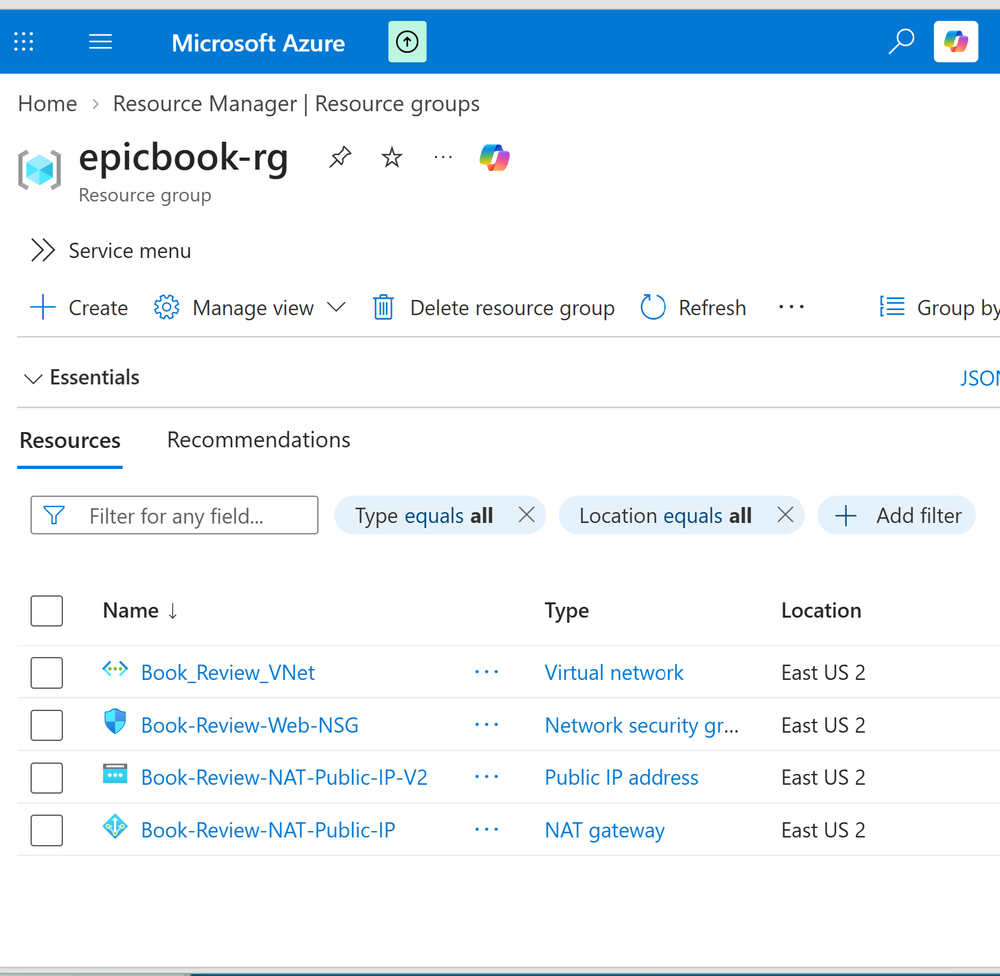

---

#### Screenshot 3 — VNet subnet configuration showing all three subnet names, CIDR ranges, and database subnet delegation

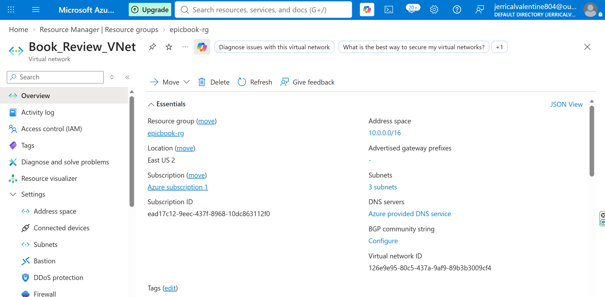

---

#### Screenshot 4 — NAT Gateway configuration showing its Public IP and associations with the web and application subnets

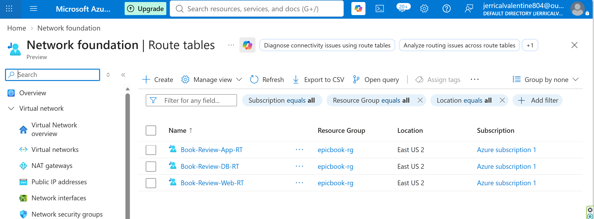

---

# Task 3 — Configure Security and Secret Management

## Goal

Configure NSGs for application, management, and health-probe traffic. Protect database credentials and the JWT signing secret. Create the Web VM with restricted SSH access and use it as the jump host for private App VM administration.

## Evidence

#### Screenshot 5 — Web, application, and database NSG rules showing permitted sources, ports, health-probe access, and applicable deny rules

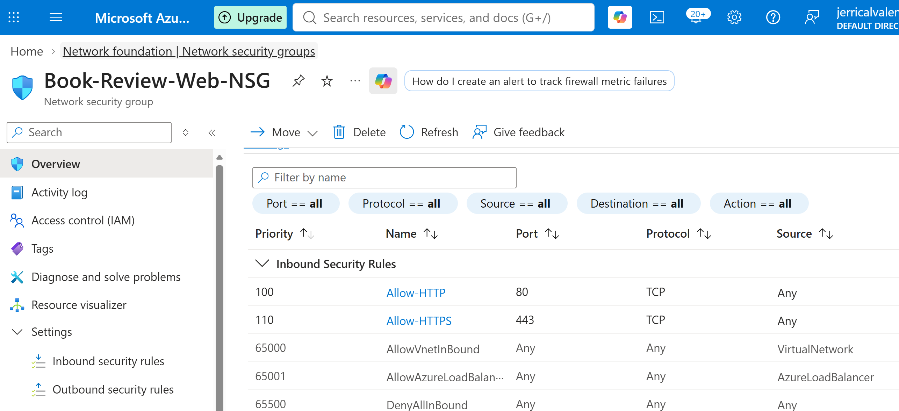

---

#### Screenshot 6 — Key Vault or the selected secret-management configuration, without displaying secret values

N/A

---

# Task 4 — Deploy the Managed Database Tier

## Goal

Create Azure Database for MySQL Flexible Server using private access in the delegated database subnet. Configure Private DNS, keep secure transport enabled, disable public access, and document backup and availability settings.

## Evidence

#### Screenshot 7 — MySQL Flexible Server networking configuration showing the private subnet and Private DNS configuration

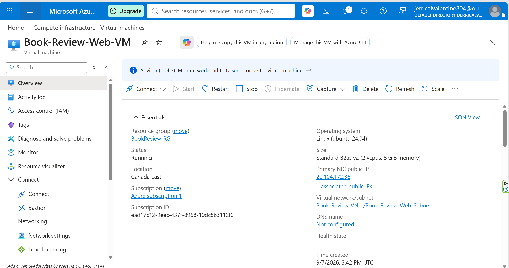

---
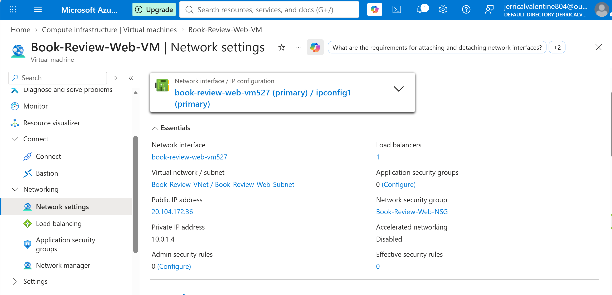

#### Screenshot 8 — Database backup-retention and availability settings

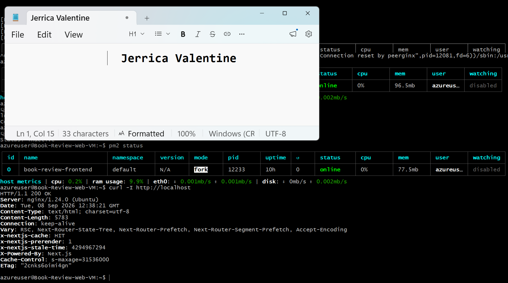
---

<<<<<<< HEAD

# Task 5 — Deploy the Business (Application) Tier
=======
#### Database Notes

Record the database service, selected capacity, backup-retention period, and recovery approach. Do not include passwords.

---

# Task 5 — Deploy the Business or Application Tier
>>>>>>> upstream/main

## Goal

Deploy the backend on one private Ubuntu VM using port **3001**. Connect to Azure MySQL over TLS, create `book_review_db` and the application database user, verify startup schema and sample-data initialization, and configure PM2 for automatic recovery.

## Evidence

#### Screenshot 9 — App VM networking configuration showing placement in the application subnet and no Public IP

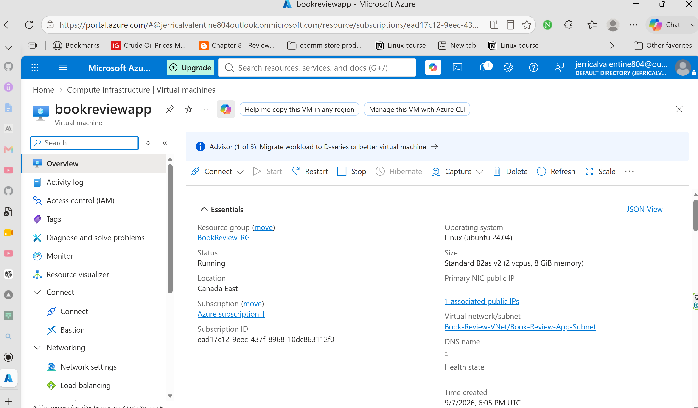

---

#### Screenshot 10 — Successful database connection and schema verification from the App VM, without displaying credentials

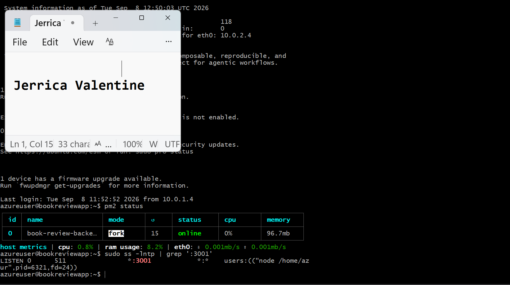

---

#### Screenshot 11 — PM2 showing `book-review-backend` online after reboot

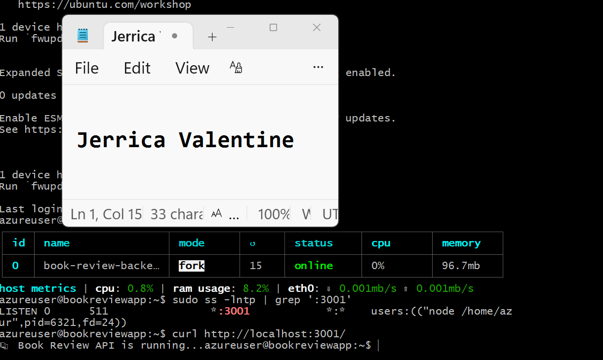

---

#### Screenshot 12 — Successful backend health or API response from the Web VM through the App VM’s private IP

---

# Task 6 — Deploy the Presentation or Web Tier

## Goal

Deploy the Next.js frontend on the existing Web VM on port **3000**. Configure Nginx on port **80** to forward page requests to the frontend and `/api/` requests to the Internal Load Balancer on port **3001**. Configure PM2 and verify recovery after reboot.

## Evidence

#### Screenshot 13 — Web VM overview or networking configuration showing its subnet and VM details

---

#### Screenshot 14 — Nginx site configuration showing frontend and API routing, together with successful `sudo nginx -t` output

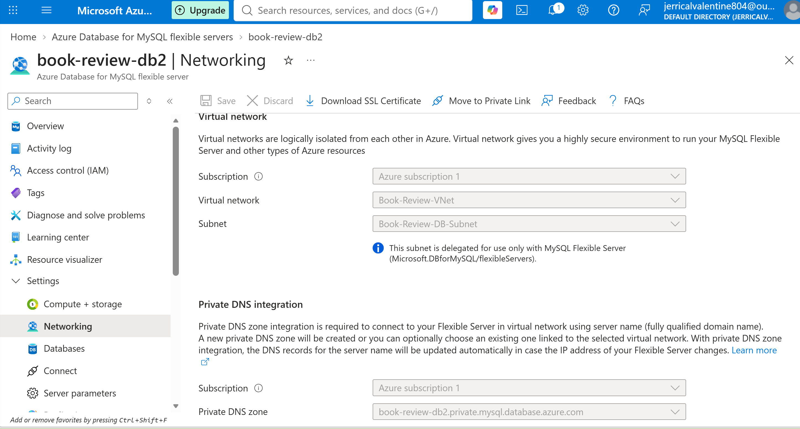

---

#### Screenshot 15 — PM2 showing `book-review-frontend` online after reboot, with Nginx active and a successful local HTTP response

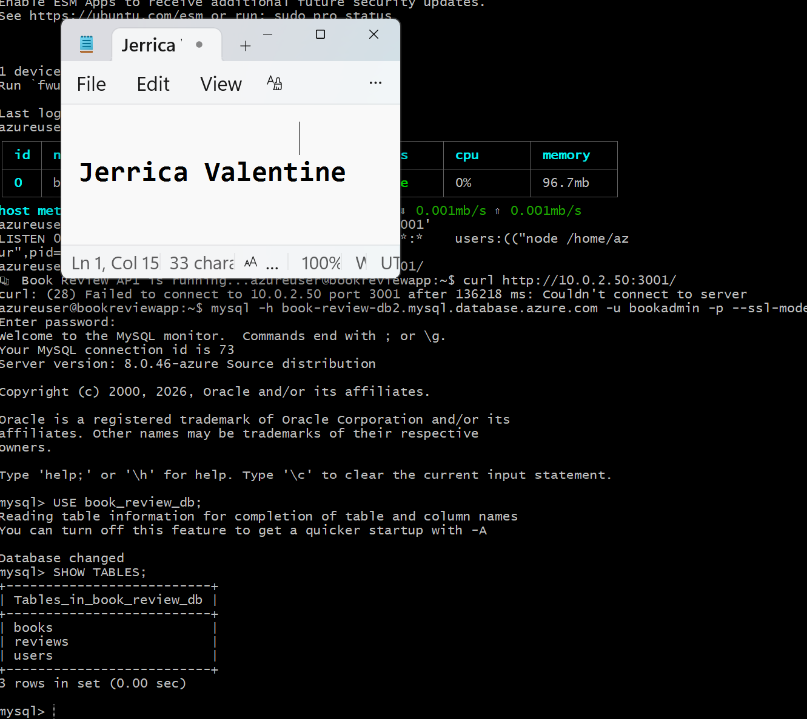
---

# Task 7 — Configure Load Balancers, Health Checks, and Monitoring

## Goal

Configure a Standard Public Load Balancer using TCP **80 → 80** and a Standard Internal Load Balancer using TCP **3001 → 3001**. Verify backend health, update the allowed frontend origin, and configure monitoring and at least one alert rule.

## Evidence

#### Screenshot 16 — Public Load Balancer frontend IP, web backend membership, TCP 80 → 80 rule, and health-probe status

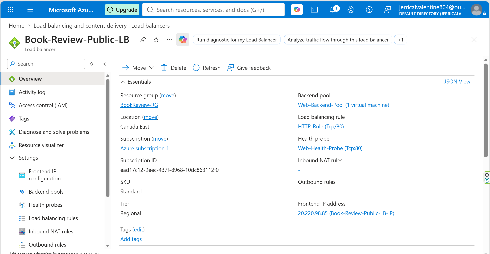

---

#### Screenshot 17 — Internal Load Balancer private frontend IP, application backend membership, TCP 3001 → 3001 rule, and health-probe status

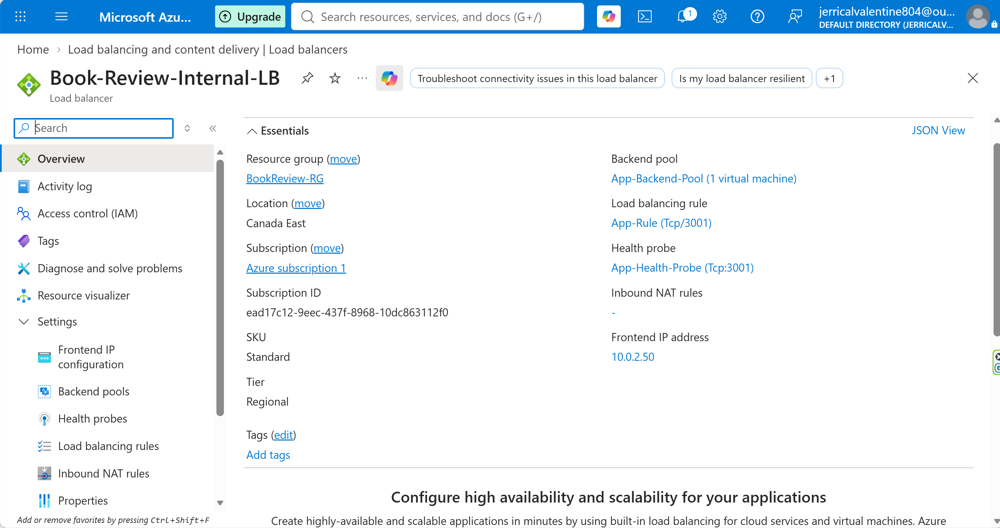

---

#### Screenshot 18 — Monitoring evidence showing a relevant metric or collected log and the configured alert rule

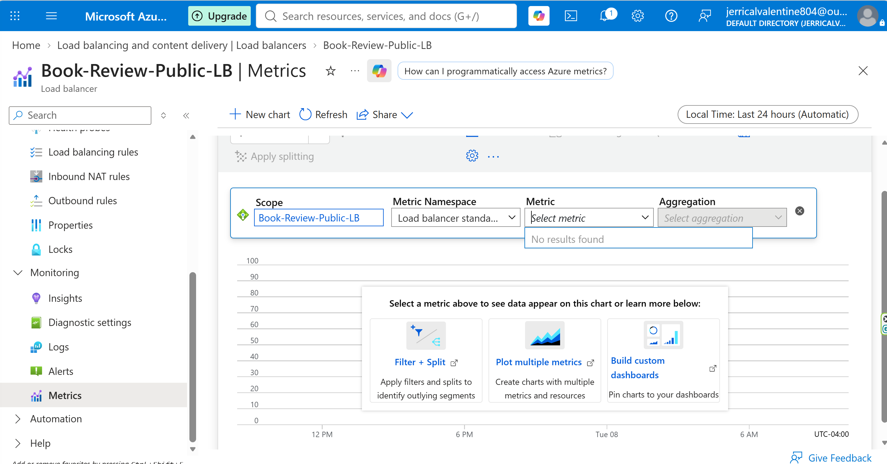
---

# Task 8 — Validate the Production-Style Deployment

## Goal

Verify registration, login, book viewing, and persistent review creation through the Public Load Balancer. Confirm private-tier restrictions and automatic service recovery after controlled App VM and Web VM restarts. Downtime is expected during these single-instance restart tests.

## Evidence

#### Screenshot 19 — Browser showing the Book Review App through the Public Load Balancer endpoint, with the address bar visible

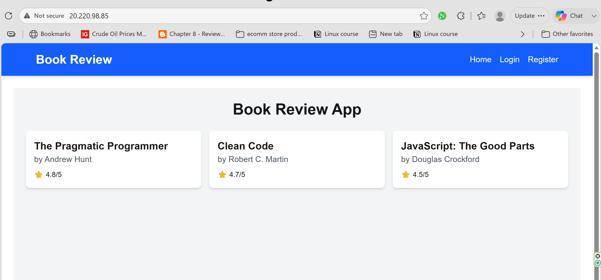

---

#### Screenshot 20 — Successful registration/login, book viewing, and review creation, with database evidence that the review persists

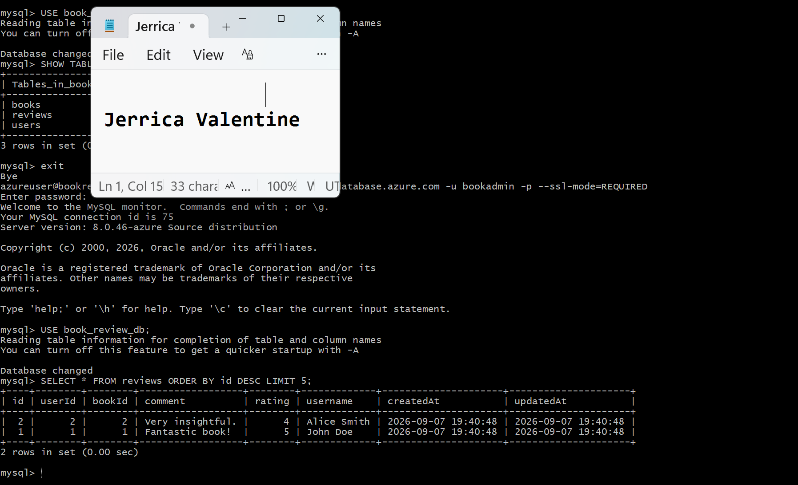

---

#### Screenshot 21 — App VM networking showing no Public IP, MySQL private-access settings, and relevant NSG restrictions

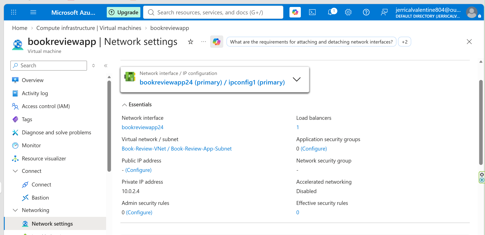

---

#### Screenshot 22 — Post-restart PM2/service status, healthy Load Balancer backends, and a successful application response

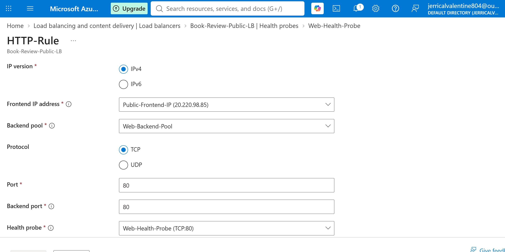

---

#### Public Endpoint

<<<<<<< HEAD
http://20.220.98.85

=======
Paste your Public Load Balancer website URL here:

`http://<PUBLIC-LB-IP>`
>>>>>>> upstream/main

---

#### Recovery Notes

Record which VM was restarted, the observed interruption, recovery time, and whether services recovered without manual startup.

---

#### Deployment Notes

Summarize what worked, issues encountered, fixes applied, and sources used. Identify the backend route used for direct and Internal Load Balancer verification, including its expected response.

---

# LinkedIn Post (Required)

## Goal

Publish a LinkedIn post with an application screenshot, your public website URL, and a caption explaining what you deployed, what you learned, one challenge you resolved, and how you verified database-backed functionality and recovery after VM restarts.

Include **#DMIByPravinMishra #Azure #DevOps #CloudComputing**. Add the credit note and tags for your track as specified in the assignment guidelines.

## Evidence

#### LinkedIn Post URL

Paste your published LinkedIn post URL here:

---

#### Screenshot 23 — Published LinkedIn post showing your caption, website URL, and application screenshot

---

# Submission Instructions

- Include your full name and Screenshots **1–23** under the corresponding evidence headings.
- Use multiple captures under an evidence heading where needed for readability.
- Include the working **public endpoint URL** and published **LinkedIn post URL**.
- Complete the architecture, database, recovery, and deployment notes.
- Ensure screenshots are readable and show your own environment.
- Do not expose passwords, private keys, tokens, connection strings containing credentials, subscription IDs, or other sensitive information.
- Submit your work using the method specified in the assignment guidelines.

---

# Completion Checklist

<<<<<<< HEAD
- [✅] Task 1: Architecture diagram and assumptions documented (Screenshots 1–2)
- [✅] Task 2: Network foundation created with isolated tiers (Screenshots 3–5)
- [✅] Task 3: Least-privilege security and secret management configured (Screenshots 6–7)
- [✅] Task 4: Presentation tier deployed (Screenshots 8–9)
- [✅] Task 5: Application tier deployed privately (Screenshots 10–12)
- [✅] Task 6: Managed database tier deployed privately (Screenshots 13–15)
- [✅] Task 7: Public entry, internal routing, and monitoring configured (Screenshots 16–18)
- [✅] Task 8: End-to-end validation and availability test completed (Screenshots 19–22, Public Endpoint, Notes)
- [✅] No sensitive data exposed
=======
- [ ] Task 1: Architecture diagram and required notes completed (Screenshot 1)
- [ ] Task 2: VNet, subnets, database delegation, and NAT Gateway configured (Screenshots 2–4)
- [ ] Task 3: NSGs and secret management configured; Web VM created for administration and frontend hosting (Screenshots 5–6)
- [ ] Task 4: Private Azure MySQL server, Private DNS, and backup settings configured (Screenshots 7–8)
- [ ] Task 5: Private backend deployed, database initialized, and PM2 recovery verified (Screenshots 9–12)
- [ ] Task 6: Frontend and Nginx routing configured, with recovery verified (Screenshots 13–15)
- [ ] Task 7: Public and Internal Load Balancers healthy; monitoring and alert configured (Screenshots 16–18)
- [ ] Task 8: Application workflows, private-tier restrictions, and restart recovery verified (Screenshots 19–22)
- [ ] Architecture, database, recovery, and deployment notes completed
- [ ] LinkedIn post published with required hashtags, credit note, and tags (Screenshot 23)
- [ ] Full name, public endpoint URL, and LinkedIn post URL included
- [ ] All screenshots readable and no sensitive information exposed
>>>>>>> upstream/main

---

## 📌 About DMI & CloudAdvisory

DevOps Micro Internship (DMI) is a project-based DevOps program run by Pravin Mishra (The CloudAdvisory) focused on real-world execution, systems thinking, and career readiness.

It helps learners build strong DevOps foundations with hands-on experience.

---

## 📌 Resources

- 🌐 DMI Official Website: https://dmi.pravinmishra.com?utm_source=github&utm_medium=readme  
- 🎓 University: https://university.pravinmishra.com?utm_source=github&utm_medium=readme  
- 💬 Discord Community: https://discord.pravinmishra.com?utm_source=github&utm_medium=readme  
- 📝 Blog: https://dmi.pravinmishra.com/blog?utm_source=github&utm_medium=readme  
- ▶️ YouTube Playlist: https://www.youtube.com/playlist?list=PLFeSNDtI4Cho  
- 🔗 Pravin Mishra (LinkedIn): https://www.linkedin.com/in/pravin-mishra-aws-trainer/  
- 🏢 CloudAdvisory (LinkedIn): https://www.linkedin.com/company/thecloudadvisory/

---

*This submission is part of DevOps Micro Internship (DMI) — Agentic AI Track.*
